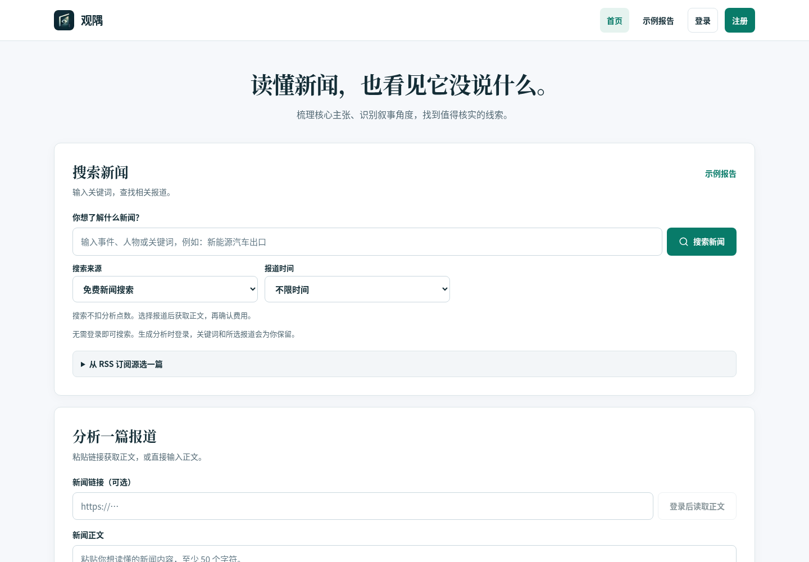
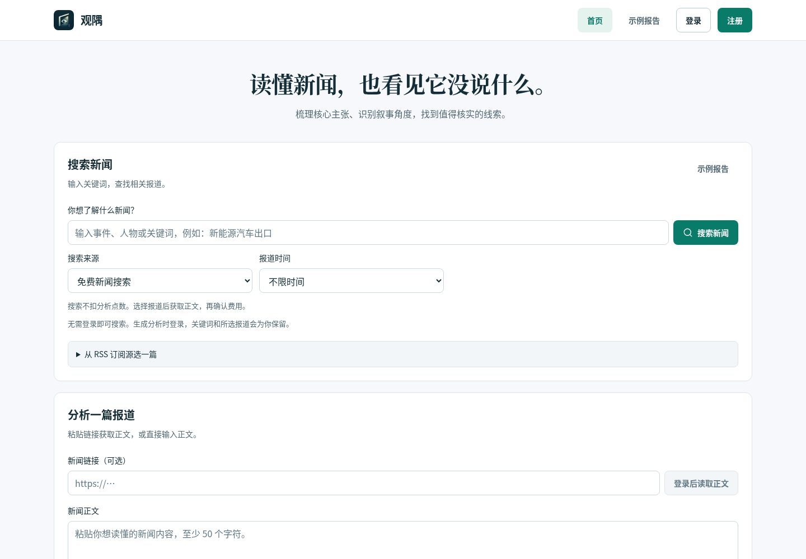
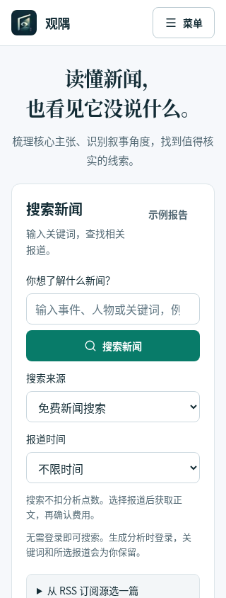
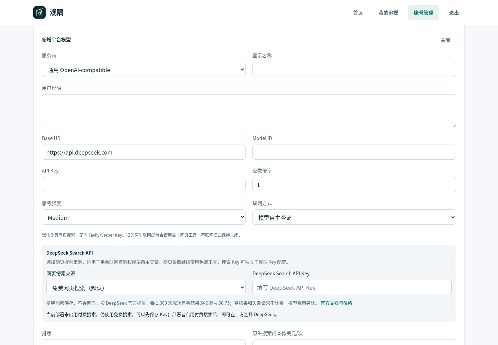
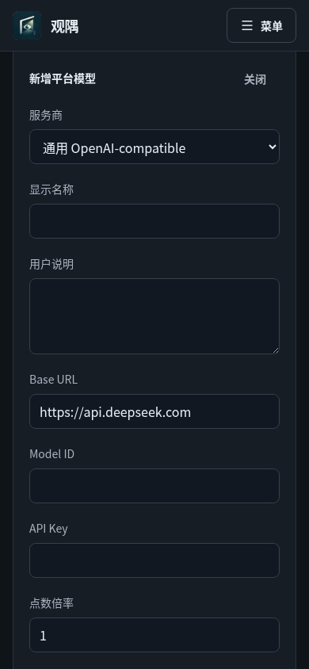

# 统一界面规范与验证记录

日期：2026-10-30（北京时间）。本轮以合并后的 `main` 为基线，解决同类控件存在多套尺寸、页面颜色分散、表单对齐不一致和装饰性动效的问题。完整标准见 [DESIGN.md](../../DESIGN.md)，后续修改入口见[项目 UI 技能](../../.agents/skills/guanyu-ui-system/SKILL.md)。

## 调研如何落地

阅读 Impeccable、UI Skills 和 Vercel Web Interface Guidelines 的相关规则，固定来源版本，整理成适用于观隅的规则。没有执行外部技能安装器，也没有为视觉改动更换技术栈。采用的原则是内容优先、原生控件、明确状态、稳定尺寸、克制动效；保留观隅的品牌和新闻阅读任务。

| 观察 | 已实施的约束 |
| --- | --- |
| 普通按钮在不同页面约为 18/28/35/39/44/50 px 高 | 共用 Button，单行最小 44 px，文字 14 px；图标按钮 44 × 44 px |
| 首页、登录、普通设置、模型管理字段大小不同 | 共用 Input / Select / Textarea；单行 44 px、16 px 字号、8 px 圆角 |
| 标签字号、字距、大小写和间距不一致 | 统一标签角色，移除标签的全大写和额外字距，标签到控件 8 px |
| 页面各自覆盖灰色、强调色、夜间色 | 使用语义变量，三套主题保持相同控件几何；原生色彩方案与主题同步 |
| 管理卡片内重复放多张数字小卡片 | 模型用量改为有标签的定义列表，数字使用 Intl 格式化 |
| 原生 confirm/prompt 与自定义弹窗外观、焦点各不相同 | 共用原生 dialog 的模态层、Escape、首尾 Tab 循环与焦点恢复；密码遮蔽 |
| 修改页面时容易重新写一套控件 | ESLint 阻止普通页面直接新增原生控件、浏览器确认弹窗或覆盖公共控件标准 |
| 动画依赖只用于入场和提示性装饰 | 删除 GSAP 包及入场/扫光；保留尊重减少动态设置的功能反馈 |

## 实际验证

- `npm run ci` 完整通过，包括现有业务、权限、报告导出、搜索及数据库检查；最终修改另跑 ESLint 和生产构建，PR CI 再验证最终提交。
- 使用生产构建、隔离的本地 PostgreSQL 和两名临时测试用户，分别检查普通用户和超级管理员页面。没有连接或修改线上数据库。
- Playwright Chromium 检查 23 个页面状态：桌面首页、登录、找回密码、示例报告、资料、偏好、历史、收藏、扩展；桌面及手机模型编辑；三套主题的手机首页、登录和报告。含 1440、390、320 px 宽度。
- 测量可见控件的实际字号、高度、圆角与标签；检查全页横向溢出和未捕获运行时异常。该检查矩阵没有发现异常。同类单行控件均符合 44 px 契约；多行选择卡片按内容增高。
- 键盘验证：跳到主要内容；确认窗口的初始取消焦点、Tab 循环、Escape 与焦点恢复；敏感密码输入遮蔽；取消不发请求；确认只删除本轮创建的收藏夹测试数据。
- 正文读取失败使用明确标记的浏览器响应夹具：保留已输入正文，Escape 返回读取按钮，手动粘贴将焦点交给编辑器。
- 对比并查看本轮新截取的截图。页面数据和管理员模型配置属于隔离的本地测试环境，不是线上数据或效果指标。

当前环境没有 Browser 插件，因此使用现有 Playwright 和 Chromium。未宣称覆盖 Safari/Firefox、真实设备的通行密钥交互、全部辅助技术或完整 WCAG 认证。数据来源、鉴权、计费和导出内容的业务规则没有在本轮调整。

## 截图

首页改动前：

首页统一后：

手机首页：

管理员模型编辑，所有单行字段共用同一规范：

同一表单的夜间手机布局：

